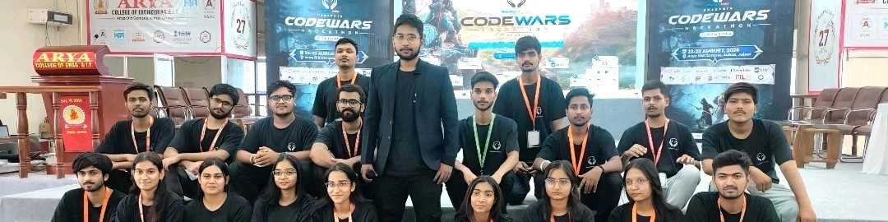

  

  <h1>Hi, I'm Shreya Singh 👋</h1>

  

  

  

*Building projects, connecting communities, and growing through technology.*

---

## 👩‍💻 About Me

Hi! I'm **Shreya Singh**, a technology enthusiast passionate about software development, artificial intelligence, cloud computing, and community building.

- 💼 Community Manager at **Hacker's Unity**
- 🌍 Organized **2× National & Global Hackathons**
- 🎙️ Hosted **6+ podcasts** with industry experts
- 🎤 Organized **5+ events, workshops, and speaker sessions**
- 🏆 Runner-up in a **Geo-Spatial Hackathon**
- 💻 Participated in **50+ hackathons**
- 🌱 Campus Ambassador at **ECSoC**
- ☁️ Interested in **Software Development, AI & Cloud Computing**
- 🤝 Open to collaborations and learning opportunities

---

## 🛠️ Languages & Tools

**Core Skills:** Data Structures & Algorithms (DSA)

---

## 🤝 Connect With Me

---

### ✨ Keep Learning. Keep Building. Keep Growing. ✨

*Thanks for visiting my profile!*

